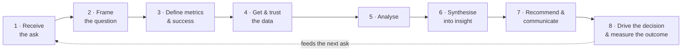

# Working as a Business Data Scientist

**The workflow, the abilities, and what good looks like — from entering the field to teaching it.**

Most of a business data scientist's day is not statistics. It is turning a vague request into a question worth answering, agreeing what success means, getting data you can trust, and then persuading someone to act on what you found. The technical work sits in the middle of that, and it is the part everyone already prepares for.

This repository makes the whole job visible: an eight-stage workflow from the first ask to the measured decision, the six abilities the work draws on, how AI agents change the division of labour, and what good looks like whether you are entering the field, doing the job, moving up, or teaching others to do it. One realistic case runs through everything, with the actual artefacts an analyst would produce.

It is written for data analysts, product analysts, and data scientists whose output is a business decision rather than a deployed model.

---

## Where are you?

| | You are… | Start here |
|---|---|---|
| **[Becoming](phases/becoming.md)** | Entering the field, or switching into it | The framework once through, then Stages 2, 4, 7 — and build one end-to-end case |
| **[Working](phases/working.md)** | In the job, roughly your first three years | Stages 1, 3, 8 — the ones nobody trained you for — and the collaboration file |
| **[Advancing](phases/advancing.md)** | Moving from doing the work to shaping it | The senior column of every ability table |
| **[Reproducing](phases/reproducing.md)** | Hiring, onboarding, mentoring, building a team | How to use this repo to transmit the job |

Preparing for interviews? Every stage and every ability has an **Interview lens** with the questions asked, what interviewers want, and worked answers. The [`interview/`](interview/) folder has the cross-cutting material.

---

## The framework



The loop ends in a **decision**, not a model. Machine learning and experimentation live inside Stage 5 as options, chosen when the question calls for them. Stages 1–3 and 7–8 are where business judgment and persuasion do most of the work; Stages 4–6 are where technical skill does. Interviews probe all eight; most candidates prepare for the middle three.

| Stage | In one line | Detail |
|---|---|---|
| 1 | Understand who is asking, what decision they face, and what they actually need | [→](stages/01-receive-the-ask.md) |
| 2 | Turn the ask into testable hypotheses with explicit scope | [→](stages/02-frame-the-question.md) |
| 3 | Agree the metrics that map to the decision, before touching data | [→](stages/03-define-metrics.md) |
| 4 | Source the data, check it, know what it cannot tell you | [→](stages/04-get-and-trust-the-data.md) |
| 5 | Do the analysis the question calls for — descriptive, diagnostic, experimental, causal — and no more | [→](stages/05-analyse.md) |
| 6 | Reduce the findings to a few claims someone can act on, with stated confidence | [→](stages/06-synthesise.md) |
| 7 | Deliver a recommendation the audience can act on, and stand behind it | [→](stages/07-recommend-and-communicate.md) |
| 8 | Get the decision made, the action taken, and the outcome measured | [→](stages/08-drive-the-decision.md) |

The framework stitches together four established ideas — Google's *Ask → Prepare → Process → Analyse → Share → Act* process, Max Shron's CoNVO scoping framework, hypothesis-driven analysis from consulting, and decision-first framing — and deliberately differs from the ML lifecycles (CRISP-DM, TDSP), which assume the deliverable is a deployed model and compress framing and communication into single phases.

---

## The matrix: stages × abilities

A workflow alone hides whatever happens *across* stages — collaboration most of all, which is everywhere and therefore nowhere. So the eight stages are crossed with six abilities:

| | Technical craft | Analytical reasoning | Business acumen | Communication | Collaboration & influence | Ownership & delivery |
|---|:-:|:-:|:-:|:-:|:-:|:-:|
| **1 Receive the ask** | ○ | ● | ●● | ● | ●● | ○ |
| **2 Frame the question** | ○ | ●● | ●● | ● | ● | ● |
| **3 Define metrics & success** | ● | ●● | ●● | ● | ●● | ○ |
| **4 Get & trust the data** | ●● | ● | ○ | ○ | ●● | ● |
| **5 Analyse** | ●● | ●● | ● | ○ | ● | ● |
| **6 Synthesise into insight** | ● | ●● | ●● | ● | ○ | ○ |
| **7 Recommend & communicate** | ○ | ● | ●● | ●● | ●● | ● |
| **8 Drive the decision & measure** | ○ | ○ | ●● | ● | ●● | ●● |

●● primary · ● supporting · ○ minor

**Two things the matrix makes visible.** Technical craft is primary in only two of eight stages. Collaboration & influence is primary in five. Most candidates prepare in inverse proportion.

**How to read it.** Down a column: where an ability is exercised, and so where to practise it. Across a row: what a stage demands, and so what an interviewer probing that stage is really assessing.

Each ability has a file in [`competencies/`](competencies/) with a definition, where it shows up in the workflow, what good looks like at junior, mid, and senior level, and the questions that probe it:

[Technical craft](competencies/technical-craft.md) · [Analytical reasoning](competencies/analytical-reasoning.md) · [Business acumen](competencies/business-acumen.md) · [Communication](competencies/communication.md) · [Collaboration & influence](competencies/collaboration.md) · [Ownership & delivery](competencies/ownership-and-delivery.md)

---

## Working with AI agents

Agents now draft the SQL, run the first pass of the analysis, and write the first version of the memo. That shifts the job rather than shrinking it: the stages where agents are weakest — framing the ask, agreeing metrics, persuading a room, driving a decision — were already most of the value, and the stages where they are strongest are the ones where an unverified output does the most damage.

Every stage file has a short **With AI** section on what to delegate there and what goes wrong. [`competencies/working-with-ai.md`](competencies/working-with-ai.md) has the full treatment: how to specify a task, how to verify what comes back, how to evaluate whether an agent is reliable enough for a kind of work, and how all of this is now assessed in interviews.

---

## The running example

*"Checkout conversion dropped 8% last month. Can you look into it?"*

One realistic case carried through all eight stages. Half the drop turns out to be a tracking break; the real drop is a payment-method failure for returning users; the fix is tested with an A/B test and shipped. The [`running-example/`](running-example/) folder holds the actual artefacts — the clarifying questions, the issue tree, the data-quality SQL, the segmentation notebook, the experiment design, the one-page memo — so the work is demonstrated rather than described.

---

## How this repo is organised

Three structures, one spine:

- **Stages** are the spine. Content lives here. Each stage file has the same four sections — what this stage is · hard skills · judgment & business skills · interview lens — plus the running example and a With AI note.
- **Abilities** are the lens. Each competency file defines one ability and indexes back into the stages. They hold the level tables and the behavioural interview material.
- **Phases** are the doors. Each is a reading path through the above for a point in your career, plus the few things specific to that phase.

```
.
├── README.md                 ← you are here
├── phases/                   ← Becoming · Working · Advancing · Reproducing
├── stages/                   ← the eight stages, fully worked
├── competencies/             ← the six abilities + working with AI
├── running-example/          ← the checkout-conversion case, with artefacts
├── interview/                ← cross-cutting interview material
└── resources.md              ← curated reading, by stage
```

---

## Role notes

One workflow, but the weight shifts by role:

| Role | Where the weight sits |
|---|---|
| **Data analyst / BI analyst** | Stages 1–4, 6–7. Stage 5 is mostly descriptive and diagnostic. |
| **Product analyst** | All stages, with Stage 3 (metrics) and Stage 5 (experimentation) emphasised. |
| **Data scientist (analytics / inference)** | Stage 5 deepens into causal inference and modelling; Stage 8 may include owning models in production. |
| **Data scientist (ML)** | A different workflow fits better (CRISP-DM / TDSP); this repo is useful for the parts of that job that touch business decisions. |

---

## About

Written by [Nathan Chen](https://github.com/NathanChen-Analyst), a business data scientist, as the map I wanted when I started and the one I now use to explain the job to others. The framework is a synthesis of established ideas; the matrix, the phase paths, the AI treatment, and the worked example are my own. If the material is useful, the best thing you can do is tell me what is missing.

## Contributing

Contributions are welcome, especially worked interview answers (question, strong answer, common weak answers), anonymised real-world examples at any stage, and adaptations that teams have made for onboarding. Please open an issue before a large pull request, and keep the four-section structure for new stage content.

## License

[CC BY 4.0](https://creativecommons.org/licenses/by/4.0/) for the text. Code samples are MIT.

---

*Related: [awesome-causal-inference](https://github.com/matteocourthoud/awesome-causal-inference) · [awesome-datascience](https://github.com/academic/awesome-datascience) · [awesome-data-analysis](https://github.com/PavelGrigoryevDS/awesome-data-analysis) · [roadmap.sh/data-analyst](https://roadmap.sh/data-analyst)*
