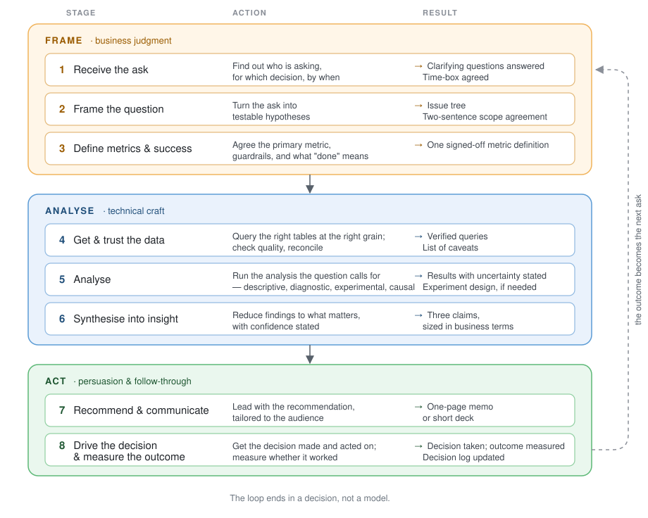

# Working as a Business Data Scientist

**The workflow, the abilities, and what good looks like — from entering the field to teaching it.**

Using data to guide decisions is fundamental to how businesses operate, which puts the business data scientist between the data and the people who have to act on it. Yet despite a vast landscape of books, courses, and repositories dedicated to statistical foundations and technical tools, far less material shows how technical, strategic, and interpersonal abilities actually come together in day-to-day work.

This repository organises those abilities around the workflow itself. By following a project stage by stage — from an initial, ambiguous ask to a measured decision — it makes visible where each ability is drawn on, what the deliverables look like, how AI agents change the division of labour, and how the standard shifts from entering the field to teaching it. One case runs through everything, with the actual artefacts an analyst would produce.

It is written for data analysts, product analysts, and data scientists whose output is a business decision rather than a deployed model. The first half describes the job as a competent practitioner does it; the second half, [Where are you?](#where-are-you), describes how the expectations shift from entering the field to teaching it.

---

## Day-to-day workflow (stage framework)

Eight stages in three bands — what you do at each, and what exists when you are done. The full treatment of every stage, with the running example, is on the [workflow page](workflow.md); the matrix below links to each stage.

<p align="center"></p>

Machine learning and experimentation live inside Stage 5 as options, chosen when the question calls for them. The Frame and Act bands are where business judgment and persuasion do most of the work; the Analyse band is where technical skill does. Interviews probe all eight stages; most candidates prepare for the middle three.

The framework stitches together four established ideas — Google's *Ask → Prepare → Process → Analyse → Share → Act* process, Max Shron's CoNVO scoping framework, hypothesis-driven analysis from consulting, and decision-first framing — and deliberately differs from the ML lifecycles (CRISP-DM, TDSP), which assume the deliverable is a deployed model and compress framing and communication into single phases.

---

## Abilities by stage (the matrix)

A workflow alone hides whatever happens *across* stages — collaboration most of all, which is everywhere and therefore nowhere. So the eight stages are crossed with six abilities:

| | [Technical craft](competencies/technical-craft.md) | [Analytical reasoning](competencies/analytical-reasoning.md) | [Business acumen](competencies/business-acumen.md) | [Communication](competencies/communication.md) | [Collaboration & influence](competencies/collaboration.md) | [Ownership & delivery](competencies/ownership-and-delivery.md) |
|---|:-:|:-:|:-:|:-:|:-:|:-:|
| **[1 Receive the ask](workflow.md#stage-1--receive-the-ask)** | ○ | ● | ●● | ● | ●● | ○ |
| **[2 Frame the question](workflow.md#stage-2--frame-the-question)** | ○ | ●● | ●● | ● | ● | ● |
| **[3 Define metrics & success](workflow.md#stage-3--define-metrics-and-success)** | ● | ●● | ●● | ● | ●● | ○ |
| **[4 Get & trust the data](workflow.md#stage-4--get-and-trust-the-data)** | ●● | ● | ○ | ○ | ●● | ● |
| **[5 Analyse](workflow.md#stage-5--analyse)** | ●● | ●● | ● | ○ | ● | ● |
| **[6 Synthesise into insight](workflow.md#stage-6--synthesise-into-insight)** | ● | ●● | ●● | ● | ○ | ○ |
| **[7 Recommend & communicate](workflow.md#stage-7--recommend-and-communicate)** | ○ | ● | ●● | ●● | ●● | ● |
| **[8 Drive the decision & measure](workflow.md#stage-8--drive-the-decision-and-measure-the-outcome)** | ○ | ○ | ●● | ● | ●● | ●● |

●● primary · ● supporting · ○ minor

**Two things the matrix makes visible.** Technical craft is primary in only two of eight stages. Collaboration & influence is primary in five. Most candidates prepare in inverse proportion.

**How to read it.** Down a column: where an ability is exercised, and so where to practise it. Across a row: what a stage demands, and so what an interviewer probing that stage is really assessing.

Each column header links to that ability's file in [`competencies/`](competencies/): a definition, the concepts and frameworks it draws on, where it shows up in the workflow, what good looks like at junior, mid, and senior level, and the questions that probe it. Each row links to that stage on the workflow page.

---

## Working with AI agents

Agents now draft the SQL, run the first pass of the analysis, and write the first version of the memo. That shifts the job rather than shrinking it: the stages where agents are weakest — framing the ask, agreeing metrics, persuading a room, driving a decision — were already most of the value, and the stages where they are strongest are the ones where an unverified output does the most damage.

Every stage on the [workflow page](workflow.md) has a short **With AI** section on what to delegate there and what goes wrong. [`competencies/working-with-ai.md`](competencies/working-with-ai.md) has the full treatment: how to specify a task, how to verify what comes back, how to evaluate whether an agent is reliable enough for a kind of work, and how all of this is now assessed in interviews.

---

## Where are you?

Everything above describes the job as a **competent, mid-level practitioner** does it: someone who can take an ambiguous ask through all eight stages, draw on all six abilities, and use AI agents without being used by them. That is the standard the rest of the repo is written to.

Expectations differ by where you are in your working life — not in *which* stages and abilities apply, but in how much of each you own and how far your judgment is trusted. Each ability file has a junior / mid / senior table that spells this out. The four pages below turn those tables into a reading path for your situation:

| | You are… | What changes from the mid-level standard |
|---|---|---|
| **[Becoming](phases/becoming.md)** | Entering the field, or switching into it | You are building toward it. Read the framework once through, then Stages 2, 4, 7, and build one end-to-end case. |
| **[Working](phases/working.md)** | In the job, roughly your first three years | You have the technical half; the gap is Stages 1, 3, 8 — the ones nobody trained you for — and the collaboration file. |
| **[Advancing](phases/advancing.md)** | Moving from doing the work to shaping it | The matrix inverts: craft becomes something you review, judgment and influence become most of the job. Read the senior column of every ability table. |
| **[Reproducing](phases/reproducing.md)** | Hiring, onboarding, mentoring, building a team | The standard becomes something you transmit. How to use this repo to onboard, review, and hire. |

Preparing for interviews? Every stage and every ability has an **Interview lens** with the questions asked, what interviewers want, and worked answers. The [`interview/`](interview/) folder has the cross-cutting material.

---

## The running example

*"Checkout conversion dropped 8% last month. Can you look into it?"*

One realistic case carried through all eight stages. Half the drop turns out to be a tracking break; the real drop is a payment-method failure for returning users; the fix is tested with an A/B test and shipped. The [`running-example/`](running-example/) folder holds the actual artefacts — the clarifying questions, the issue tree, the data-quality SQL, the segmentation notebook, the experiment design, the one-page memo — so the work is demonstrated rather than described.

---

## How this repo is organised

Three structures, one spine:

- **Stages** are the spine. Content lives here, on one page ([workflow.md](workflow.md)). Each stage has the same four sections — what this stage is · hard skills · judgment & business skills · interview lens — plus the running example and a With AI note.
- **Abilities** are the lens. Each competency file defines one ability and indexes back into the stages. They hold the level tables and the behavioural interview material.
- **Phases** are the doors. Each is a reading path through the above for a point in your career, plus the few things specific to that phase.

```
.
├── README.md                 ← you are here
├── phases/                   ← Becoming · Working · Advancing · Reproducing
├── workflow.md               ← the eight stages, fully worked, on one page
├── competencies/             ← the six abilities + working with AI
├── running-example/          ← the checkout-conversion case, with artefacts
├── interview/                ← cross-cutting interview material
└── resources.md              ← curated reading, by stage
```

---

## Role notes

One workflow, but the weight shifts by role:

| Role | Where the weight sits |
|---|---|
| **Data analyst / BI analyst** | Stages 1–4, 6–7. Stage 5 is mostly descriptive and diagnostic. |
| **Product analyst** | All stages, with Stage 3 (metrics) and Stage 5 (experimentation) emphasised. |
| **Data scientist (analytics / inference)** | Stage 5 deepens into causal inference and modelling; Stage 8 may include owning models in production. |
| **Data scientist (ML)** | A different workflow fits better (CRISP-DM / TDSP); this repo is useful for the parts of that job that touch business decisions. |

---

## About

Written by [Nathan Chen](https://github.com/NathanChen-Analyst), a business data scientist, as the map I wanted when I started and the one I now use to explain the job to others. The framework is a synthesis of established ideas; the matrix, the phase paths, the AI treatment, and the worked example are my own. If the material is useful, the best thing you can do is tell me what is missing.

## Contributing

Contributions are welcome, especially worked interview answers (question, strong answer, common weak answers), anonymised real-world examples at any stage, and adaptations that teams have made for onboarding. Please open an issue before a large pull request, and keep the four-section structure for new stage content.

## License

[CC BY 4.0](https://creativecommons.org/licenses/by/4.0/) for the text. Code samples are MIT.

---

*Related: [awesome-causal-inference](https://github.com/matteocourthoud/awesome-causal-inference) · [awesome-datascience](https://github.com/academic/awesome-datascience) · [awesome-data-analysis](https://github.com/PavelGrigoryevDS/awesome-data-analysis) · [roadmap.sh/data-analyst](https://roadmap.sh/data-analyst)*
